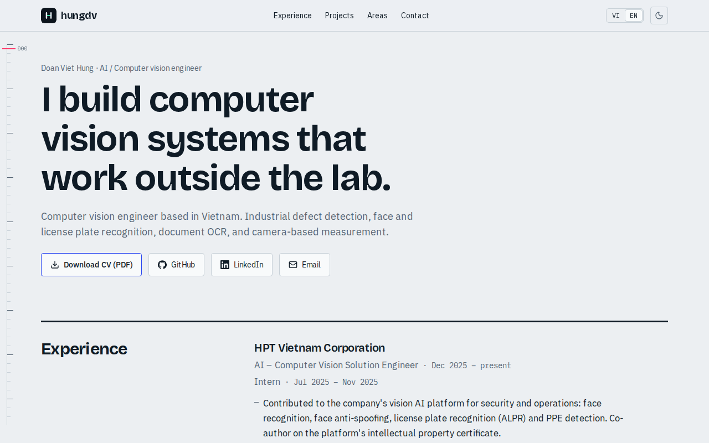

# hungdv.io.vn

Bilingual (VI/EN) portfolio of Doan Viet Hung, computer vision engineer. Live at **https://hungdv.io.vn**.

Each project has a small interactive model that runs on synthetic data in the browser: defect threshold, tiling, OCR job flow, camera-to-ground measurement and a multi-stage safety pipeline.



**Stack:** Next.js 16 (static export), React 19, TypeScript, Tailwind CSS 4, Playwright, Nginx.

```bash
npm install
npm run dev            # http://localhost:3000/vi/
npm run build          # static site in out/
npm test               # Playwright tests against out/ (build first)
npm run check:secrets  # scan out/ for IPs, keys, forbidden terms
./deploy/deploy.sh               # on the VPS itself: build, check, copy out/ to /var/www/hungdv.io.vn
```

- Text: `content/vi.ts`, `content/en.ts` (same `Content` type, so a missing string fails the build).
- Email, LinkedIn, CV files, and whether to show the Anomaly_LineScan figures: `content/site.ts`.
- CV: put `Doan-Viet-Hung-CV-en.pdf` (and optionally `-vi.pdf`) into `public/cv/`; the download button appears automatically.
- Client or company names that must never appear: one per line in `scripts/forbidden.txt` (git-ignored).
- Nginx: `deploy/nginx.conf`, then `sudo certbot --nginx -d hungdv.io.vn -d www.hungdv.io.vn`.
